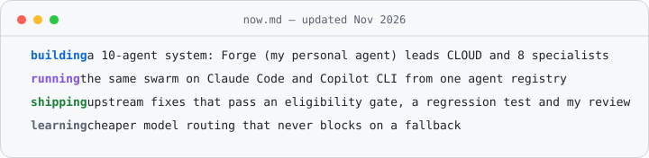
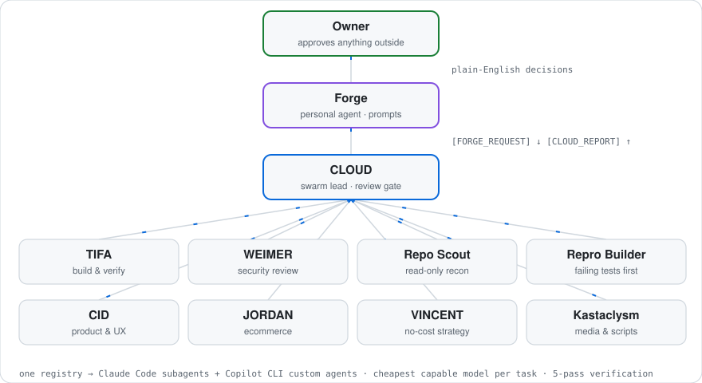

  <picture>
    <source media="(prefers-color-scheme: dark)" srcset="assets/header-dark.svg">
    
  </picture>

  <picture>
    <source media="(prefers-color-scheme: dark)" srcset="assets/now-dark.svg">
    
  </picture>

  
  
  
  
  
  
  
  
  
  

---

Engineer in Los Angeles / Long Beach. I build software that has to be trusted
before it's clever: multi-agent systems with real approval gates, cloud
automation that fails loudly, and fixes that arrive with the test that proves
them.

## What I work on

**Agent systems people can actually supervise.** Most of my time goes to the
parts that decide whether an AI system is safe to leave running: who is allowed
to act, what happens when a step fails, and how a person stays in the loop
without reading every log.

**Upstream fixes, evidence first.** Before I touch someone else's project I
check that the issue is real, unclaimed and wanted, read the contribution
rules, and write the failing test. Then the fix.

**Cloud and defensive security.** Container builds, AWS reliability work, threat modelling and hardening of
common attack paths.

## The system I run

  <picture>
    <source media="(prefers-color-scheme: dark)" srcset="assets/swarm-dark.svg">
    
  </picture>

- **One agent talks to me.** Forge holds my priorities and turns decisions
  into plain English. CLOUD runs the swarm and reports back to Forge in a fixed
  format, so nothing gets lost between them.
- **Nothing leaves the machine without me.** Pushes, PRs, posts and purchases
  wait for my approval of the exact item. An agent's confidence is not approval.
- **Cheapest model that can do the job.** The lead picks a model per task and
  escalates only after a real, revised attempt fails. A model fallback is
  logged, not treated as a blocker.
- **One source, two platforms.** A single registry generates the same agents
  for Claude Code and GitHub Copilot CLI, with tests that fail if they drift.

## Selected work

### [llmops-infra-guide](https://github.com/OBOneProtocol/llmops-infra-guide)

A local LLM writes a Dockerfile, `docker build` judges it, and the build
errors feed the next attempt. A small loop with a ground-truth validator;
documented samples cover Flask, Node.js and Go.

### Merged upstream

- **[career-ops #3711](https://github.com/career-ops-hq/career-ops/pull/3711)**
  — detect project-scoped Playwright MCP installs, with precedence-aware config
  and regression tests.
- **[career-ops #3591](https://github.com/career-ops-hq/career-ops/pull/3591)**
  — harden context-budget prompt assembly and tracker-path handling.

### In review upstream (opened November 2026)

- **[mypy #22438](https://github.com/python/mypy/pull/22438)**
  — treat writable callable attributes as invariant in PEP 695 variance
  inference.
- **[ruff #30317](https://github.com/astral-sh/ruff/pull/30317)**
  — `F402`: report loop variables that shadow imports inside conditional
  branches, matching pyflakes (preview-gated).
- **[ruff #30318](https://github.com/astral-sh/ruff/pull/30318)**
  — `PLW0406`: report `from <module> import` of the current module, matching
  pylint (preview-gated).
- **[conductor #1831](https://github.com/conductor-oss/conductor/pull/1831)**
  — keep the MySQL queue's unack sweep running after one failed run, so a
  dropped connection doesn't strand workflows until restart.
- **[agent-browser #2549](https://github.com/vercel-labs/agent-browser/pull/2549)**
  — let `frame "#selector"` resolve cross-origin iframes, with an end-to-end
  test against real Chrome.

## How I work, specifically

- A bug report becomes a failing test before it becomes a diff
- "Works on my machine" is an environment finding, not a fix
- A mismatch between code and docs might be a design decision; I ask first
- Every external action is non-idempotent until proven otherwise: gate it,
  don't retry it
- Notes are part of the system: decisions and lessons get written down, dated,
  and corrected when they turn out wrong

---

  

