  <picture>
    <source media="(prefers-color-scheme: dark)" srcset="assets/header-dark.svg">
    
  </picture>

  <picture>
    <source media="(prefers-color-scheme: dark)" srcset="assets/now-dark.svg">
    
  </picture>

  
  
  
  
  
  
  
  
  
  

---

More than four years on the service desk taught me that a failure people can
see is easier to fix than one that stays hidden, and I build AI automation and
cloud tooling around that idea. The multi-agent systems I design keep the human
in the lead, so the agents draft and test the work and nothing goes out under my
name until I approve it. The proof is below: an LLMOps infrastructure guide and
upstream pull requests, merged and in review, backed by regression tests.

**Open to:** AI automation, cloud security and technical support roles · Los Angeles / Long Beach area or remote

## Selected work

### [llmops-infra-guide](https://github.com/OBOneProtocol/llmops-infra-guide)

A generate-and-validate loop: an LLM drafts a Dockerfile, `docker build`
acts as the ground-truth validator, and build errors feed the next attempt.
Documented samples cover Flask, Node.js and Go.

### Merged upstream

- **[career-ops #7098](https://github.com/career-ops-hq/career-ops/pull/7098)**  
  The updater reported "up to date" on the main channel when the commit
  lookup failed (an API rate limit, for example). It now reports drift; a test
  stubs the failed lookup.
- **[sure #5038](https://github.com/we-promise/sure/pull/5038)**  
  Stored Brandfetch logo URLs resolve with the current client ID, so rotating
  the ID in settings repairs existing merchant and security logos without a
  data backfill.
- **[ttt #1601](https://github.com/eugenioenko/ttt/pull/1601)**  
  New untitled buffers inherit the editor's `insertSpaces` and `tabSize`
  settings, covered by a regression test and verified against the built binary.
- **[career-ops #3711](https://github.com/career-ops-hq/career-ops/pull/3711)**  
  Detect project-scoped Playwright MCP installs, with precedence-aware config
  resolution and regression tests.
- **[career-ops #3591](https://github.com/career-ops-hq/career-ops/pull/3591)**  
  Harden context-budget prompt assembly and tracker-path handling.

### In review upstream (opened November 2026)

- **[conductor #1831](https://github.com/conductor-oss/conductor/pull/1831)**  
  Keep the MySQL queue's unack sweep scheduled after a failed run, so a
  dropped database connection no longer strands workflows until restart.
  Review feedback addressed; awaiting maintainer review.
- **[agent-browser #2549](https://github.com/vercel-labs/agent-browser/pull/2549)**  
  `frame "#selector"` resolves cross-origin iframes, covered by an
  end-to-end test against real Chrome.

### Building now (private)

- **AI-assisted IT service desk.** Agents handle intake, triage and
  first-line remediation. A fix that fails review gets up to three examined
  fixes, each driven by the reviewer's findings, before the ticket escalates
  to a technician. Privileged actions such as password resets require a human
  approver.
- **Operator console for the agent team.** Halt a run, preserve its session,
  and review the report every run produces.

## What I work on

**Supervised agent systems.** Permission boundaries for agent actions, failure
handling that recovers or halts in a known state, and oversight that keeps a
human in the lead through approval gates and per-run reports instead of log
review.

**Upstream contributions.** Every fix starts with evidence: reproduce the
issue, confirm it is unclaimed and that maintainers want it, follow the
project's contribution and AI policies, and land a failing regression test
before changing code.

**Cloud and defensive security.** Container build pipelines, AWS reliability,
threat modeling, and hardening against common attack paths: prompt injection,
over-privileged CI tokens, unpinned dependencies.

## The system I run

A multi-agent system, a lead orchestrator with specialist roles, running on Claude
Code and Copilot CLI, among other tools. Its operating model borrows from IT
service management.

  <picture>
    <source media="(prefers-color-scheme: dark)" srcset="assets/system-dark.svg">
    
  </picture>

- **Human in the lead.** External writes (pull requests, public posts,
  anything that spends money) are gated on my approval of the exact item.
  Agent confidence is not authorization.
- **Independent verification.** The final reviewer reruns the test suite and
  reads the diff directly. A summary from another agent is not evidence.
- **Examined fixes, not blind retries.** On failure, the agent records what
  failed, the likely root cause and what the next attempt changes, bounded at
  three attempts. With no new hypothesis, it halts and escalates with the
  evidence.
- **Resumable take-over.** Any run can be stopped and handed to a person at
  the same step, with its session history intact.

## Engineering principles

- A bug report becomes a failing test before it becomes a diff.
- "Works on my machine" is an environment finding, not a fix.
- A mismatch between code and docs may be intentional; I confirm with the
  maintainers before changing either.
- Every external action is non-idempotent until proven otherwise: gate it,
  don't retry it.
- If another contributor claims an issue first, my fix stays local.
- Decisions and lessons are written down, dated, and revised when they prove
  wrong.

## Activity

  <picture>
    <source media="(prefers-color-scheme: dark)" srcset="https://raw.githubusercontent.com/OBOneProtocol/OBOneProtocol/output/impact-dark.svg">
    
  </picture>

  <picture>
    <source media="(prefers-color-scheme: dark)" srcset="https://raw.githubusercontent.com/OBOneProtocol/OBOneProtocol/output/github-contribution-grid-snake-dark.svg">
    
  </picture>

---

  
  

