  <picture>
    <source media="(prefers-color-scheme: dark)" srcset="assets/header-dark.svg">
    
  </picture>

  <picture>
    <source media="(prefers-color-scheme: dark)" srcset="https://raw.githubusercontent.com/OBOneProtocol/OBOneProtocol/output/impact-dark.svg">
    
  </picture>

  <b>Open to</b> AI automation, cloud security and technical support roles · Los Angeles / Long Beach area or remote  
  
  

The service desk taught me that a failure people can see is easier to fix than
one that stays hidden. I build AI automation and cloud tooling on that idea:
agents draft and test the work, and nothing goes out under my name until I
approve it.

## Upstream contributions

Each fix starts from a reproduction and lands with a regression test. The
table rebuilds itself from GitHub, and the badges show live state.

<!-- contributions:start -->
<table>
<tr><th align="left">Project</th><th align="left">Pull request</th><th align="left">What changed for users</th></tr>
<tr><td rowspan="4" valign="top"> <a href="https://github.com/career-ops-hq/career-ops"><b>career-ops</b></a>  On the project's Contributor team since November 2026.</td><td valign="top" nowrap><a href="https://github.com/career-ops-hq/career-ops/pull/7800"><b>#7800</b></a> </td><td valign="top">test(check-liveness-flags): scale the per-child spawnSync timeout on Windows</td></tr>
<tr><td valign="top" nowrap><a href="https://github.com/career-ops-hq/career-ops/pull/7098"><b>#7098</b></a> </td><td valign="top">The updater no longer says "up to date" when the commit lookup fails, such as on an API rate limit. It reports drift, and a test stubs the failed lookup.</td></tr>
<tr><td valign="top" nowrap><a href="https://github.com/career-ops-hq/career-ops/pull/3711"><b>#3711</b></a> </td><td valign="top">The doctor command detects project-scoped Playwright MCP installs, resolving config in precedence order.</td></tr>
<tr><td valign="top" nowrap><a href="https://github.com/career-ops-hq/career-ops/pull/3591"><b>#3591</b></a> </td><td valign="top">Hardened context-budget prompt assembly and tracker-path handling.</td></tr>
<tr><td valign="top"> <a href="https://github.com/we-promise/sure"><b>sure</b></a> </td><td valign="top" nowrap><a href="https://github.com/we-promise/sure/pull/5038"><b>#5038</b></a> </td><td valign="top">Rotating the Brandfetch client ID in settings repairs every stored merchant and security logo, with no data backfill.</td></tr>
<tr><td valign="top"> <a href="https://github.com/eugenioenko/ttt"><b>ttt</b></a> </td><td valign="top" nowrap><a href="https://github.com/eugenioenko/ttt/pull/1601"><b>#1601</b></a> </td><td valign="top">New untitled files follow the editor's insertSpaces and tabSize settings, checked against the built binary.</td></tr>
<tr><td valign="top"> <a href="https://github.com/vercel-labs/agent-browser"><b>agent-browser</b></a>  My fix was folded into a maintainer PR, with co-author credit.</td><td valign="top" nowrap><a href="https://github.com/vercel-labs/agent-browser/pull/2737"><b>#2737</b></a>  co-author, from my <a href="https://github.com/vercel-labs/agent-browser/pull/2549">#2549</a></td><td valign="top">frame "#selector" resolves cross-origin iframes, covered by an end-to-end test in real Chrome.</td></tr>
<tr><td valign="top"> <a href="https://github.com/conductor-oss/conductor"><b>conductor</b></a> </td><td valign="top" nowrap><a href="https://github.com/conductor-oss/conductor/pull/1831"><b>#1831</b></a> </td><td valign="top">The MySQL queue keeps its unack sweep scheduled after a failed run, so a dropped DB connection no longer strands workflows until restart.</td></tr>
</table>
<!-- contributions:end -->

## My own work

**[llmops-infra-guide](https://github.com/OBOneProtocol/llmops-infra-guide)**
 
An LLM writes a Dockerfile, `docker build` is the judge, and build errors go
back into the next attempt. Offline test suite, read-only CI, and safety checks
that refuse risky Dockerfiles before they build.

## Building now (private)

  <picture>
    <source media="(prefers-color-scheme: dark)" srcset="assets/now-dark.svg">
    
  </picture>

  
  
  
  
  
  
  
  
  
  

<b>What I work on</b>

 

- **Supervised agent systems.** Permission boundaries for agent actions,
  failures that recover or halt in a known state, and approval gates with a
  report for every run.
- **Upstream fixes.** Reproduce the issue, confirm it is unclaimed and wanted,
  follow the project's contribution and AI policies, then write the failing
  test before the code.
- **Cloud and defensive security.** Container build pipelines, AWS reliability,
  and hardening against prompt injection, over-privileged CI tokens and
  unpinned dependencies.

<b>The system I run</b>

 

A lead orchestrator with specialist roles, running on Claude Code and Copilot
CLI, among other tools. The operating model borrows from IT service management.

  <picture>
    <source media="(prefers-color-scheme: dark)" srcset="assets/system-dark.svg">
    
  </picture>

- **Human in the lead.** Pull requests, public posts and anything that spends
  money wait for my approval of the exact item.
- **Independent verification.** The final reviewer reruns the tests and reads
  the diff. Another agent's summary is not evidence.
- **Examined fixes, not blind retries.** Each attempt records what failed, the
  likely cause and what the next one changes, up to three. Then it escalates.
- **Resumable take-over.** A person can stop any run and pick it up at the same
  step, with its session intact.

<b>Engineering principles</b>

 

- A bug report becomes a failing test before it becomes a diff.
- "Works on my machine" is an environment finding, not a fix.
- A mismatch between code and docs may be intentional, so I ask the
  maintainers before changing either.
- External actions are non-idempotent until proven otherwise: gate them, don't
  retry them.
- If someone else claims an issue first, my fix stays local.
- Decisions are written down, dated, and revised when they prove wrong.

## Activity

  <picture>
    <source media="(prefers-color-scheme: dark)" srcset="https://raw.githubusercontent.com/OBOneProtocol/OBOneProtocol/output/github-contribution-grid-snake-dark.svg">
    
  </picture>

